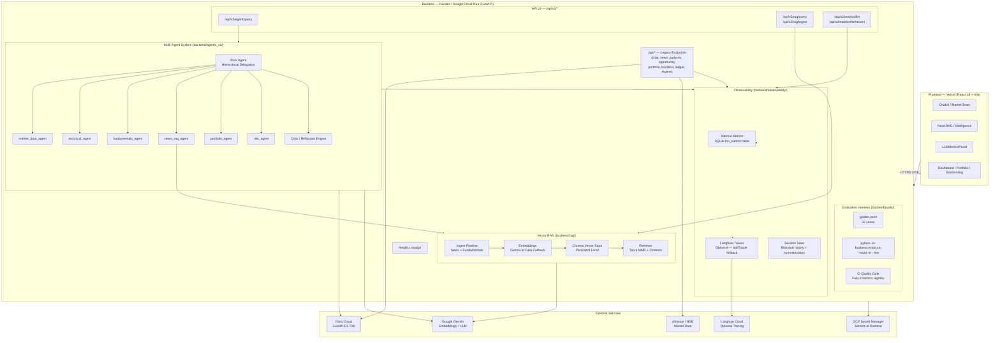
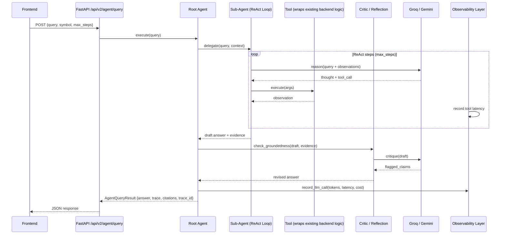
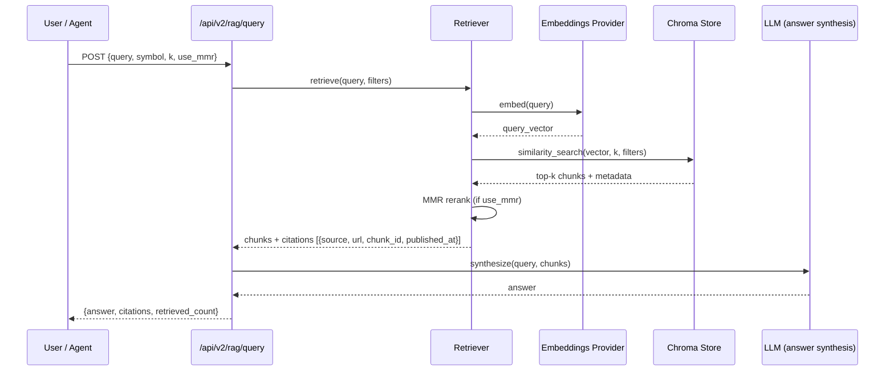
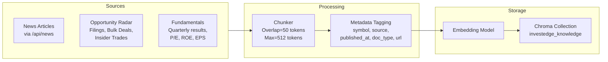
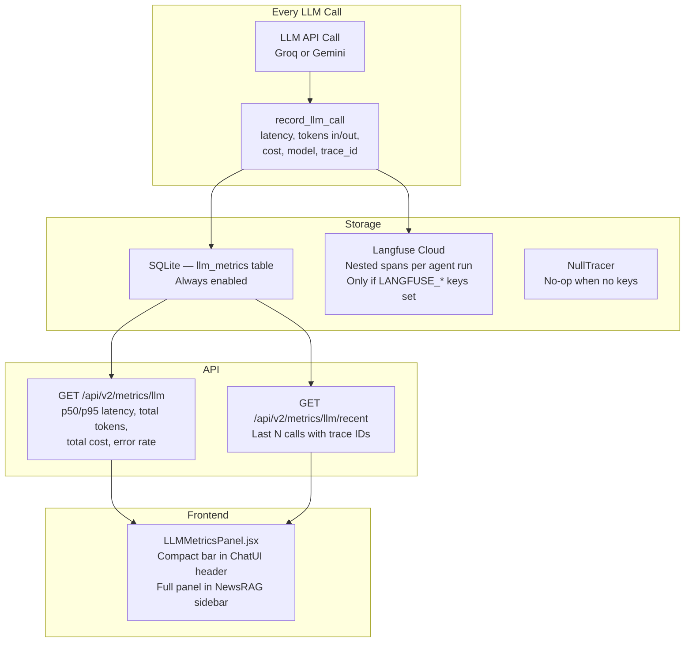
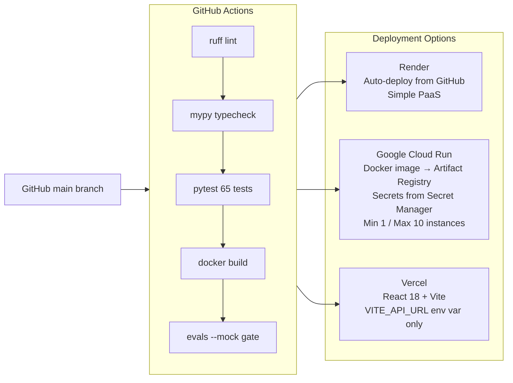
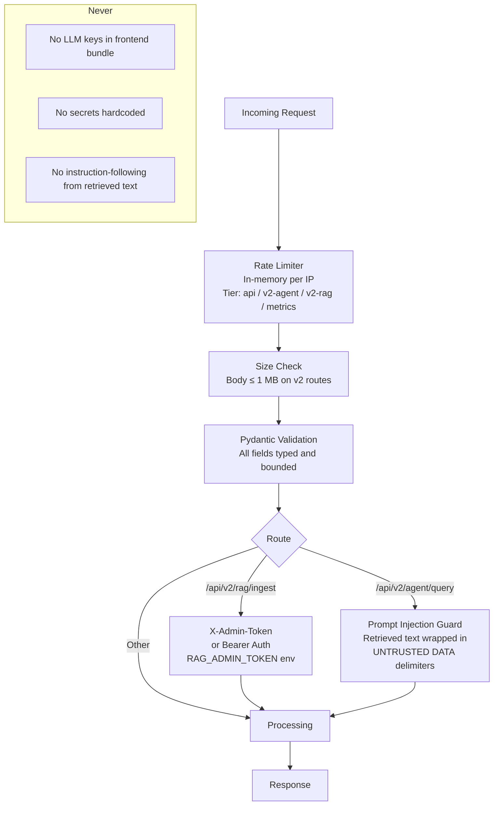
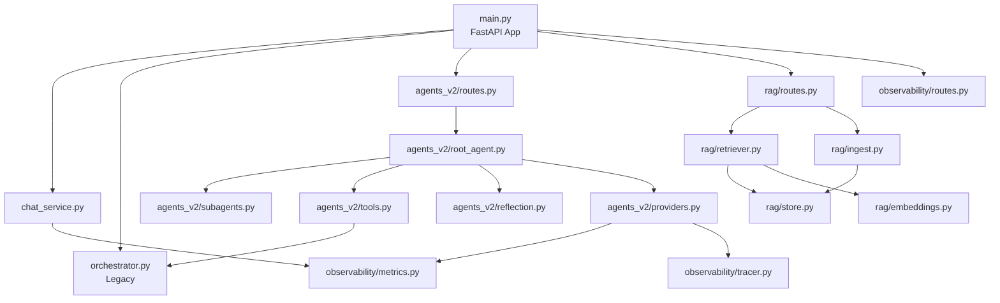

# InvestEdge — System Architecture

> Version: Post-Phase-8 Production Upgrade  
> Generated: 2026-11-19

---

## High-Level Architecture

---

## Data Flow — Agent Query

---

## Data Flow — RAG Query

---

## Ingestion Pipeline

---

## Observability Stack

---

## Deployment Topology

---

## Security Architecture

---

## Module Dependency Map

